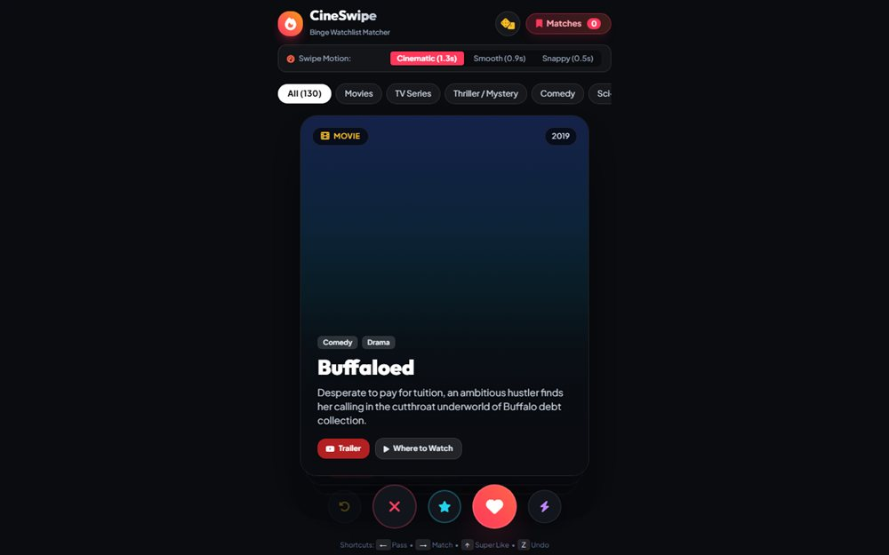

# CineSwipe - Your Movie & TV Matcher

Tinder for your watchlist: swipe through films and series, keep what you like, and let the shortlist build itself.

**[Open the live site](https://ajeet-iitk.github.io/MovieRecommendation1/)**

## What it does

CineSwipe shows one title at a time as a card. Swipe or click to say yes or no; the ones you keep collect into a personal shortlist. Choices survive a refresh because they are written to `localStorage`.

## Features

- Card stack with swipe-style interaction
- Like / skip decisions kept in `localStorage`
- Card transitions rendered on canvas
- Tailwind styling, no build step

## Run locally

Open `index.html`, or use the hosted copy:

<https://ajeet-iitk.github.io/MovieRecommendation1/>

## Files

| File | Purpose |
| --- | --- |
| `index.html` | Landing page |
| `cineswipe_tinder_for_your_watchlist.html` | The app |

---

Part of [my collection of small projects](https://github.com/Ajeet-iitk).
